# Лабораторная работа №6 "Система контроля версий"
## Цель работы
Цель работы: изучение базовых возможностей системы управления версиями, опыт работы с Git Api, опыт работы с локальным и удаленным репозиторием.
## Задание на лабораторную работу
1. Создать аккаунт на сайте GitHub.
2. Сделать копию в личное хранилище из https://github.com/Kurtyanik/LR6/ (Fork).
3. Установить Git (https://git-scm.com/).
4. После установки настроить клиент git, введя имя пользователя (Группа Фамилия И.О.) и email.
5. Клонировать свой личный удалённый репозиторий на компьютер.
6. Добавить файл через интерфейс GitHub. Подтянуть изменения в локальный репозиторий.
7. Получить историю операций для каждой из веток.
8. Просмотреть последние изменения.
9. Выполнить слияние в ветку master, разрешив конфликт (можно использовать специальные редакторы или графический интерфейс git).
10. Удалить побочную ветку после успешного слияния.
11. Сделать изменения и зафиксировать их, оставляя комментарии, несколько раз.
12. Сделать откат коммита.
13. Создать ветку для отчёта.
14. Начать оформлять отчёт в файле README.md (разрешены сторонние редакторы с подсветкой синтаксиса), используя markdown синтаксис (https://guides.github.com/features/mastering-markdown/):
15. Получить историю операций в форматированном виде (сокращённый хэш + дата + имя автора + комментарий). Добавить её в отчёт и сделать финальную фиксацию изменений.
16. Отправить локальные изменения в сетевое хранилище GitHub (если делаете работу постепенно, то синхронизацию проводить в конце рабочего сеанса)
## Ход работы
### 1. Создание аккаунта на сайте GitHub
Аккаунт на сайте уже был, поэтому вместо регистрации был произведён вход
### 2. Сделать копию в личное хранилище 
Указанный репозиторий был скопирован при помощи функции fork (рис. 1).
<p align="center">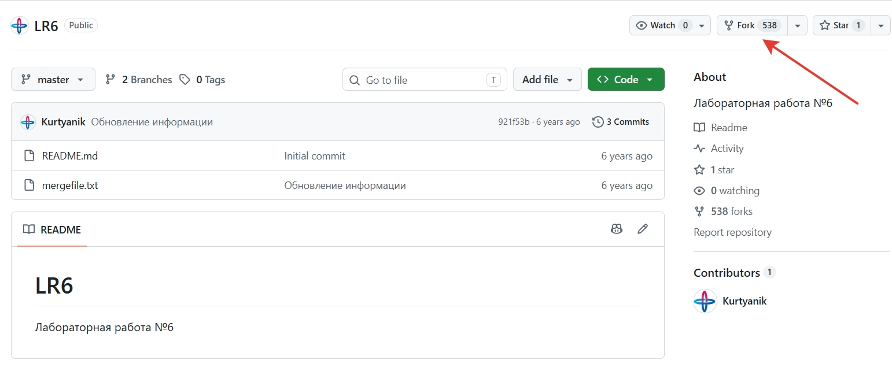</p>
<p align="center">Рисунок 1 - Копирование репозитория</p>

### 3. Установить Git
По указанной ссылки открылся сайт (рис. 2). На нём необходимо выбрать версию, скачать установщик и следовать его инструкциям.
<p align="center">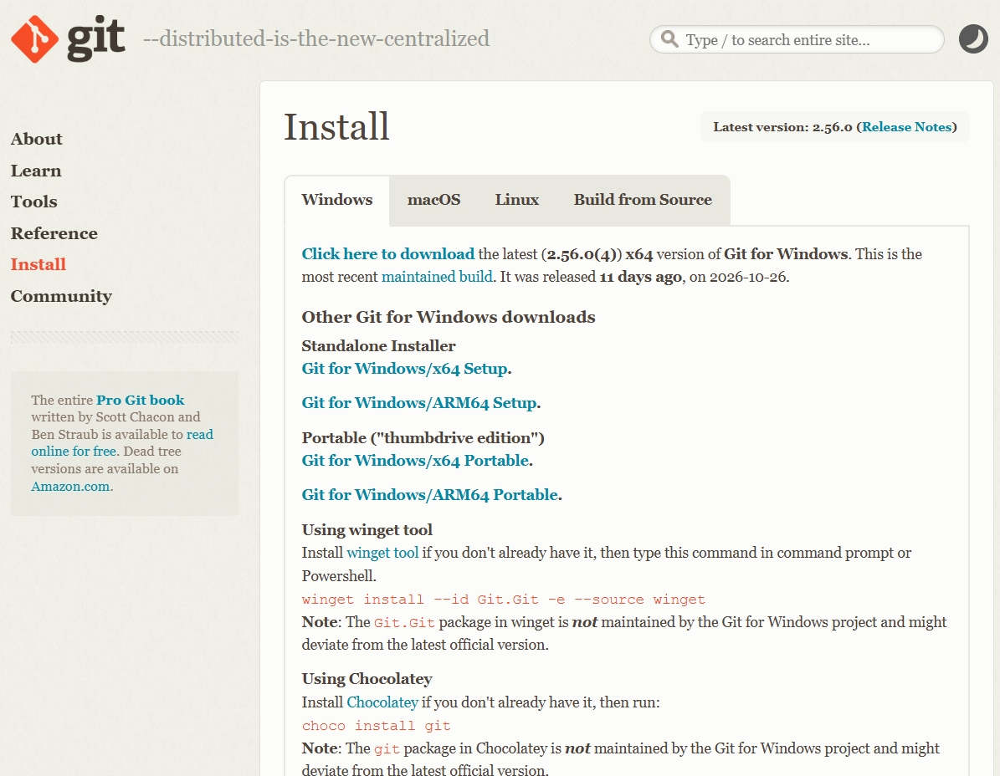</p>
<p align="center">Рисунок 2 - Скачивание Git</p>

### 4. Настроить клиент Git
Чтобы указать имя пользователя и email в клиенте Git, необходимо воспользоваться соответствующими командами:
```
git config --global user.name "(username)"
git config --global user.email "(email)"
```
<p align="center">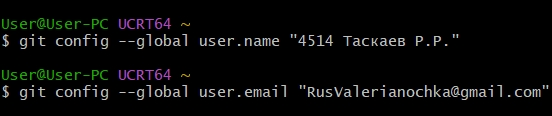</p>
<p align="center">Рисунок 3 - Настройка клиента Git</p>

### 5. Клонирование удалённого репозитория на компьютер
Для клонирования своего личного удалённого репозитория на компьютер сначала нужно перейти в папку, где должен храниться репозиторий. Это осуществляется с помощью команды:
```
cd (путь)
```
Затем, можно клонировать удалённый репозиторий на свой компьютер (рис. 4) с помощью следующей команды:
```
git clone (ссылка на удалённый репозиторий)
```
<p align="center">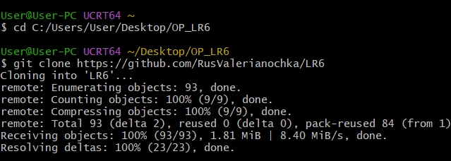</p>
<p align="center">Рисунок 4 - Клонирование удалённого репозитория на компьютер</p>

### 6. Создание нового файла. Подтягивание изменений в локальный репозиторий
В интерфейсе GitHub был создан новый файл (рис. 5).
<p align="center">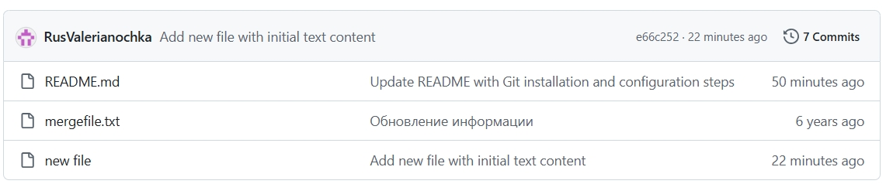</p>
<p align="center">Рисунок 5 - Новый файл</p>

Чтобы установить изменения в локальном репозитории, необходимо в него перейти и воспользоваться командой:
```
git pull
```
Чтобы просмотреть файлы в локальном репозитории, необходимо ввести команду:
```
ls -1
```
На рисунке 6 представлены файлы репозитория до и после добавления нового файла.
<p align="center">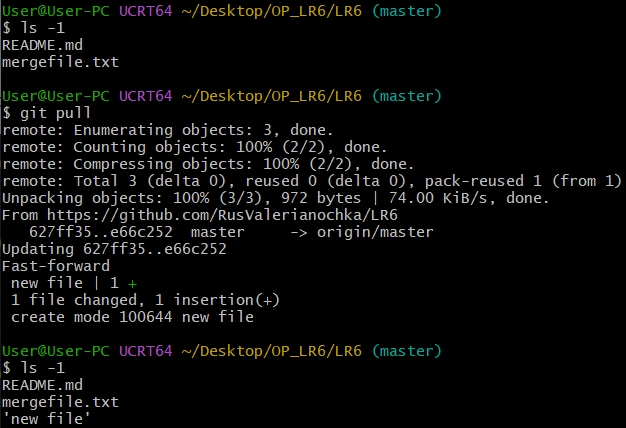</p>
<p align="center">Рисунок 6 - Установка изменений в локальном репозитории</p>

### 7. Получение истории операций для каждой из веток
Для получения истории операций ветки используется следующая команда:
```
git log (название ветки)
```
Для перехода в другую ветку используется команда:
```
git checkout (название ветки)
```
История операций для имеющихся веток master (рис. 7) и branch1 (рис. 8).
<p align="center">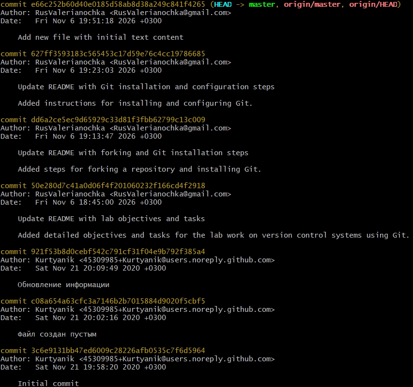</p>
<p align="center">Рисунок 7 - История операций ветки master</p>
<p align="center">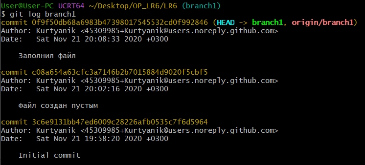</p>
<p align="center">Рисунок 8 - История операций ветки branch1</p>

### 8. Просмотр последних изменений 
Чтобы просмотреть последние изменения необходимо использовать команду:
```
git show (название ветки)
```
Результаты ипользования данной команды для ветки master представленны на рисунке 9
<p align="center">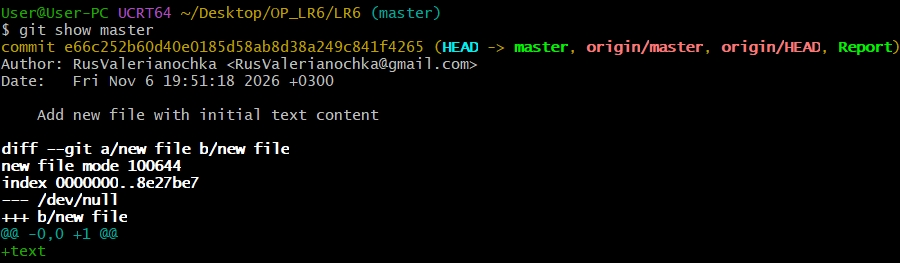</p>
<p align="center">Рисунок 9 - Последние изменений ветки master</p>
### 9. Слияние с разрешением конфликта
Чтобы слить ветки, необходимо войти в ту ветку, в которую будет происходить слияние, и воспользоваться командой:
```
git merge (название ветки, которую нужно слить)
```
При попытке слить ветку branch1 с веткой master произошёл конфликт (рис. 10).
<p align="center">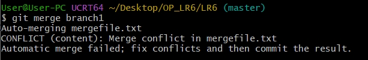</p>
<p align="center">Рисунок 10 - Конфликт</p>

Для решения конфликта файл был отредактирован в графическом редакторе (рис. 11).
<p align="center">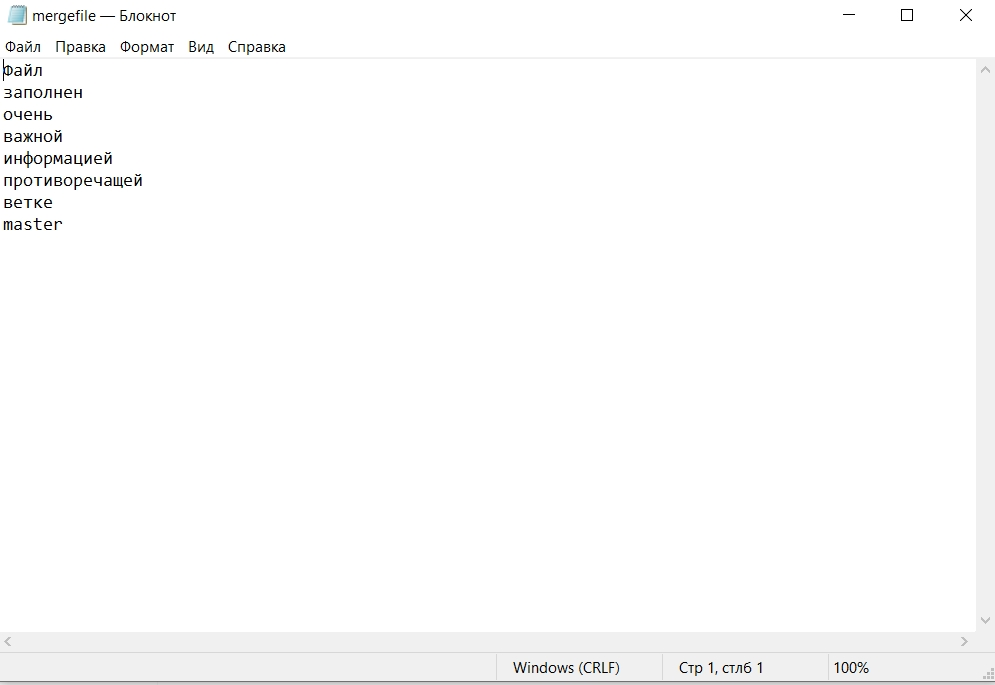</p>
<p align="center">Рисунок 11 - Редактирование файла</p>

После того как конфликт разрешён, полученный файл необходимо зафиксировать. Для этого сначала добавляем его в индекс с помощью команды:
```
git add (Название файла)
```
Затем проверям, что он добавился в индекс:
```
git status
```
И последним шагом фиксируем изменения, чтобы завершить слияние (рис. 12) с помощью команды:
```
git commit -m "(Комментарий)"
```
Чтобы передать все изменения в ветке master в удалённый репозиторий, необходимо воспользоватсья командой:
```
git push
```
<p align="center">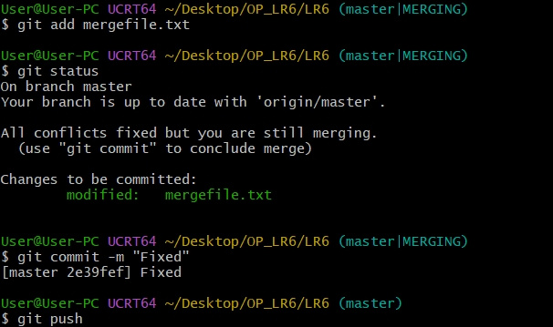</p>
<p align="center">Рисунок 12 - Завершение слияния веток</p>

### 10. Удаление побочной ветки
Ветка branch1 была удалена (рис. 13).
Чтобы удалить ветку локально используется команда:
```
git branch -d (Название ветки)
```
Для удаления из удалённого репозитория используется команда:
```
git push origin --delete (Название ветки)
```
<p align="center">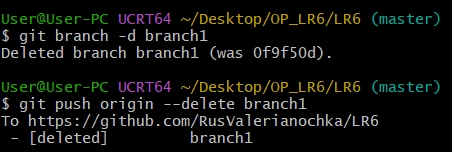</p>
<p align="center">Рисунок 13 - Удаление ветки branch1</p>

### 11. Создание изменений и их фиксация
Для создания и редактирования файлов применяется команда:
```
echo "(Новое содержание файла)" > (Название файла)
```
Было создано и добавлено в удалённый репозиторий 2 файла (рис. 14-15).
<p align="center">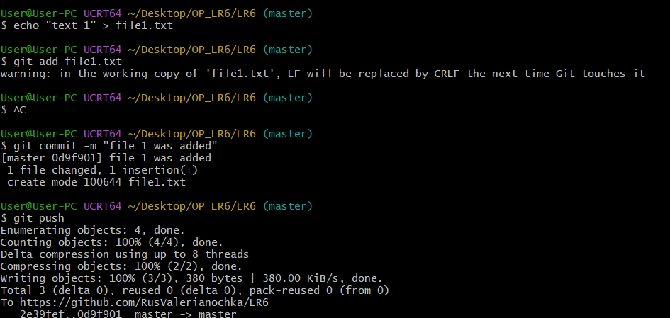</p>
<p align="center">Рисунок 14 - Добавление file1</p>
<p align="center">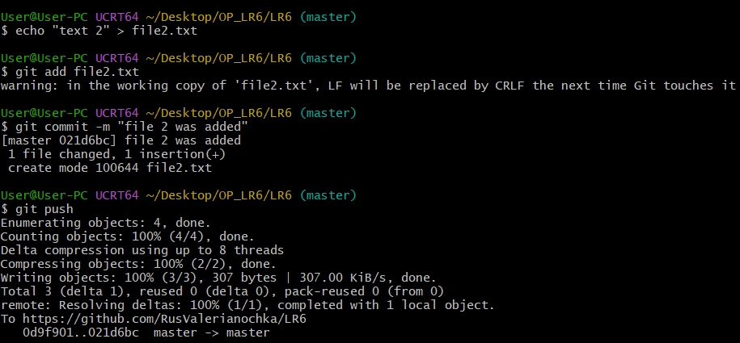</p>
<p align="center">Рисунок 15 - Добавление file2</p>

### 12. Создание отката коммита 
Для отката коммита используется команда:
```
git reset HEAD~1
```
Ниже видна история коммитов до команды (рис. 16) и после (рис. 17).
<p align="center">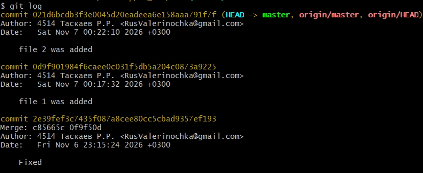</p>
<p align="center">Рисунок 16 - История коммитов до отката</p>
<p align="center">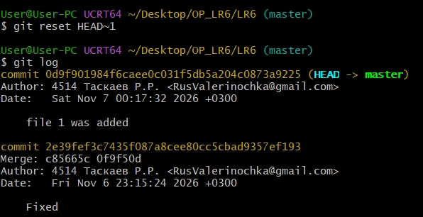</p>
<p align="center">Рисунок 17 - История коммитов после отката file2</p>

### 13. Создание ветки для отчёта
Для создания новой ветки применяется команда:
```
git branch (Название новой ветки)
```
Для отправки новой ветки в удалённый репозиторий используется команда:
```
git push origin (Название новой ветки)
```
Была создана ветка report для написания в ней отчёта (рис. 18).
<p align="center">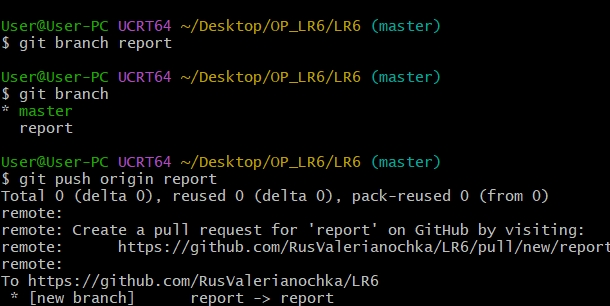</p>
<p align="center">Рисунок 18 - Создание ветки для отчёта</p>

### 14. Написание отчёта
Отчёт был написан в тектовом редакторе с последующим копированием в файл README.md в ветке report (рис. 19).
<p align="center">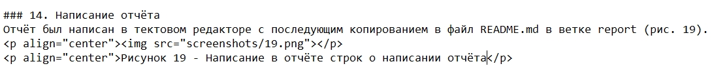</p>
<p align="center">Рисунок 19 - Написание в отчёте строк о написании отчёта</p>

### 15. История операций
Чтобы получить историю операций в форматированном виде (рис. 20) (сокращённый хэш + дата + имя автора + комментарий), необходимо воспользоваться командой:
```
git log --date=format:'%D' --pretty=format:"%h -> %cd, %cn ( %s )"
```
<p align="center">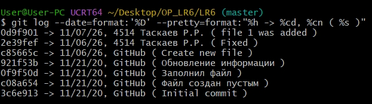</p>
<p align="center">Рисунок 20 - История операций</p>

### 16. Отправка локальных изменений в сетевое хранилище
Все изменения были скопированны в удалённый репозиторий

## Лог команд
git config --global user.name "4514 Таскаев Р.Р."

git config --global user.email "RusValerinochka@gmail.com"

cd C:/Users/User/Desktop/OP_LR6

git clone https://github.com/RusValerianochka/LR6

cd LR6/

ls -1

git pull

ls -1

git log master

git checkout brаnch1

git log branch1

git checkout master

git show master

git merge branch1

git add mergefile.txt

git status

git commit -m "Fixed"

git push

git branch -d branch1

git push origin --delete branch1

echo "text 1" > file1.txt

git add file1.txt

git commit -m "file 1 was added"

git push

echo "text 2" > file2.txt

git add file2.txt

git commit -m "file 2 was added"

git push

git log

git reset HEAD~1

git log

git branch report

git branch

git push origin report
## Вывод
В ходе выполнения лабораторной работы были изучены базовые возможностей системы управления версиями, получен опыт работы с Git Api, опыт работы с локальным и удаленным репозиторием.
